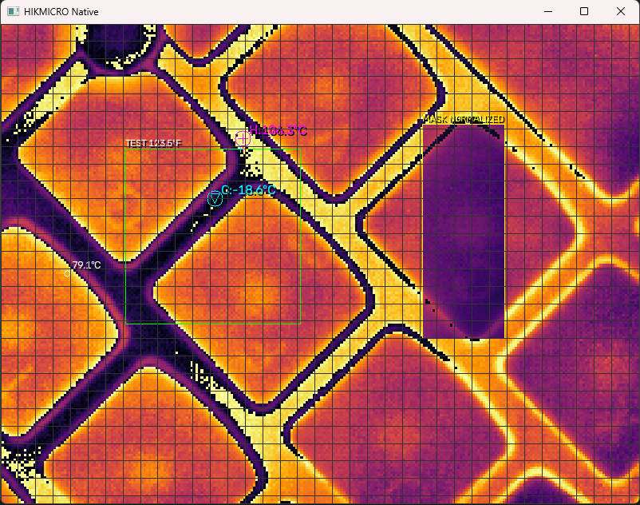
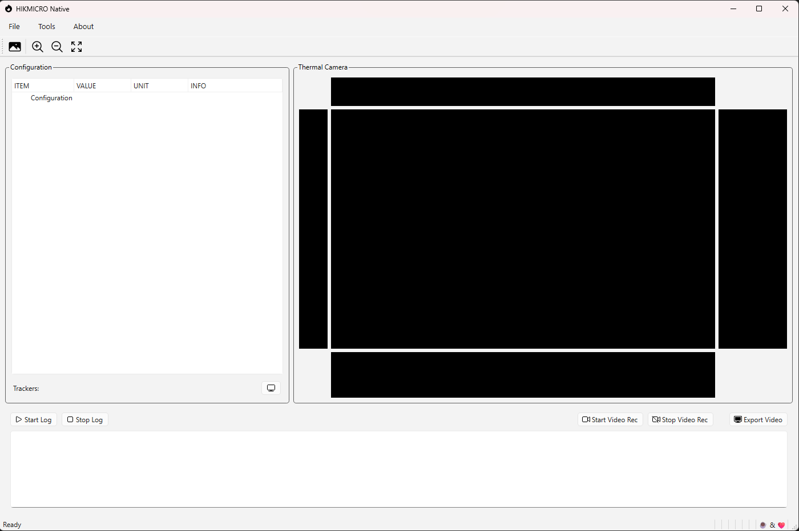
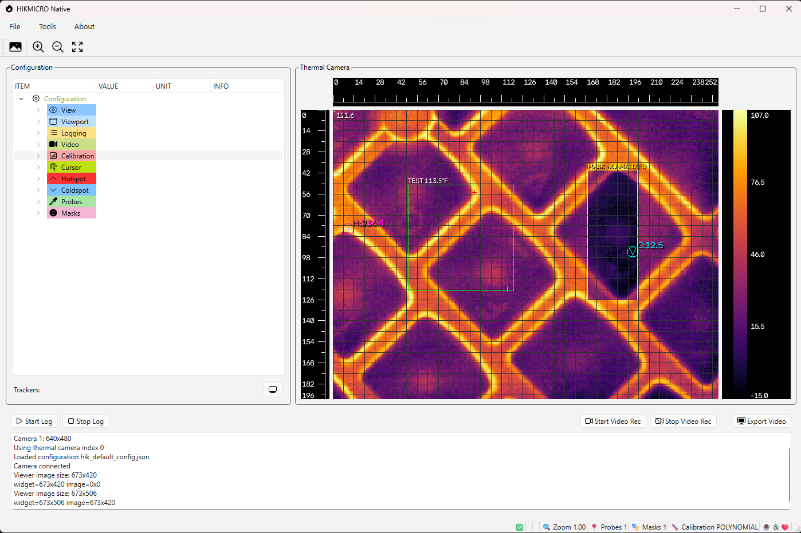
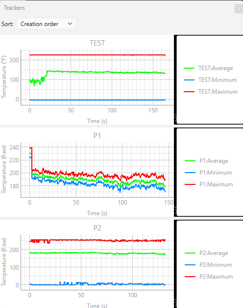
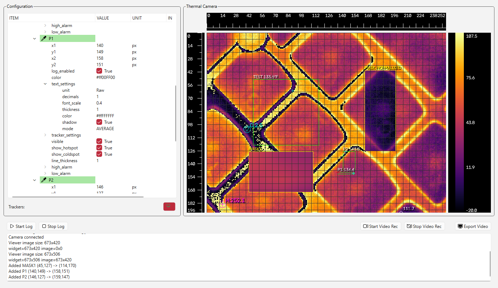

# HIKMICRO Native

Cross-platform thermal imaging and analysis application.

HIKMICRO Native is a Python-based thermal imaging application designed for HIKMICRO thermal cameras.

It provides live thermal image acquisition, temperature analysis, calibration, measurement regions, alarms, logging, video recording and visualization.

The application is built around a reusable thermal imaging engine, with two different interfaces:

- A standalone OpenCV interface.
- A graphical interface built with PyQt6.

Both interfaces use the same underlying thermal processing functionality and JSON configuration system.

## 1. Features

- Automatic thermal camera detection.
- Live thermal image acquisition.
- Thermal image visualization and colormap selection.
- Temperature calibration using polynomial coefficients.
- Hotspot and coldspot detection.
- Cursor temperature measurements.
- Multiple independent measurement probes.
- High and low temperature alarms.
- Configurable measurement masks.
- Normalized and raw measurement modes.
- CSV temperature logging.
- Raw thermal recording.
- MP4 video export.
- Configurable video inspection reports.
- Image viewport and zoom control.
- Grid, rulers and measurement overlays.
- JSON-based configuration management.
- Virtual camera mode.
- Raw thermal recording in NPZ format.
- Memory-efficient batched recording architecture.
- Offline video rendering and MP4 export.
- Historical probe tracking.
- Post-processing can be coupled using visualization settings (colors, text settings)
- External alarm trigger execution.
- Python, Batch, Shell and Executable alarm actions.

## Documentation

Detailed documentation is available in the `docs` directory.

| Topic | Description |
|---------|-------------|
| [Configuration](docs/configuration.md) | Complete JSON configuration reference |
| [Probes and Masks](docs/probes_and_masks.md) | Measurement regions, interactions and analysis modes |
| [Recording](docs/recording.md) | Raw thermal recording, MP4 generation and post-processing |
| [Virtual Camera](docs/virtual_camera.md) | NPZ playback and offline processing |
| [Trackers](docs/trackers.md) | Historical probe visualization and plotting |
| [Alarms](docs/alarms.md) | Alarm system and external trigger execution |


## 2. Architecture

The application is divided into two main components.

### 2.1 Thermal engine: `class_hikmicro_native.py`

This is the core application class.

It contains the camera interface, thermal processing functions, measurements, calibration, visualization, logging, recording and configuration management.

The engine is independent of the graphical interface.

It can be instantiated and controlled directly from Python.

The class also includes an OpenCV-based basic interface for standalone operation and development.

### 2.2 Graphical interface: `hik_app_main.py`

The GUI is built using PyQt6.

It acts as a user interface and controller for the thermal engine.

Its responsibilities include:

- Initializing the thermal engine.
- Displaying the live thermal image.
- Providing configuration controls.
- Managing user interactions.
- Adding and editing probes and masks.
- Triggering screenshots and other operations.
- Logging, Video Recording and export operations.
- Managing application configuration.
- Live Trackers for Probes

The GUI does not implement a separate thermal processing engine. It uses the functionality provided by `class_hikmicro_native.py`.

## 3. Operation modes

The application supports two operation modes.

### Mode 1: Standalone / Native OpenCV mode

The thermal engine can run independently, without the PyQt6 graphical interface.

This mode is particularly useful for:

- Development and debugging.
- Automated thermal measurements.
- Integration into other Python applications.
- Testing camera acquisition / other cameras.
- Running thermal analysis programmatically.
- Headless or automated workflows, where supported by the selected functionality.

The native class provides direct access to the camera and thermal processing functions.

Basic interactions include:

- Capturing screenshots.
- Adding measurement probes.
- Moving and resizing probes.
- Adding measurement masks.
- Moving and resizing masks.
- Performing thermal measurements.
- Accessing the thermal image and processing results.
- Logging
- Video Recording
- Alarm Triggering
- Events and state machine

Probe and mask interactions are performed through mouse operations when using the OpenCV interface.

#### Running native mode

The core class includes an executable example under:

`if __name__ == "__main__":`

Run it using:

`python class_hikmicro_native.py`

This allows the thermal engine to be tested independently of the GUI.

##### Keyboard Shortcuts

The OpenCV interface supports a number of keyboard shortcuts for quick operation during acquisition and analysis.

| Key | Action |
|------|----------|
| Esc | Exit application |
| g | Toggle grid |
| h | Toggle hotspot display |
| c | Toggle coldspot display |
| p | Toggle probe display |
| u | Toggle cursor display |
| m | Toggle mask display |
| x | Toggle center cross |
| + | Zoom in |
| - | Zoom out |
| # | Fit image to viewport |
| s | Save snapshot |
| k | Save configuration |
| l | Load configuration |

These shortcuts are primarily intended for Native OpenCV mode and provide quick access to commonly used visualization and configuration functions.

#### Mouse Interaction

The OpenCV interface provides direct mouse-based interaction with probes and masks.

##### Probes

- Ctrl + Left-click and drag: Create a probe.
- Ctrl + Right-click: Delete the probe closest to the clicked position.

##### Masks

- Shift + Left-click and drag: Create a mask.
- Shift + Right-click: Delete the mask closest to the clicked position.

##### Notes

The closest probe or mask is determined automatically based on the mouse position.

The keyboard shortcuts provide quick access to the most commonly used visualization and configuration functions.

Not all application features are currently exposed through keyboard shortcuts. The native interface focuses on essential thermal inspection workflows, while the PyQt interface provides access to the complete configuration system.

Additional shortcuts and functionality can be integrated easily through the OpenCV interface as development continues.

### Mode 2: Graphical application mode

The graphical application uses the same thermal engine but provides a PyQt6 interface.

The GUI is intended for interactive thermal inspection and configuration.

It provides access to the engine's functionality through graphical controls.

The GUI acts as a shell around the native thermal class.

#### Running GUI mode

The main application entry point is:

`python hik_app_main.py`

Both GUI and core initializes the thermal engine settings and loads the configuration from:

`hik_default_config.json`

### Important distinction

Both operation modes share the same thermal processing implementation.

The difference is the interface used to interact with the engine.

The standalone OpenCV interface is useful for development, automation and direct engine access. It lack user interface controls to change settings or activate functionalities.

The PyQt6 interface provides a more complete graphical environment for interactive operation.

## 4. Installation

### Python requirements

Create a virtual environment:

`python -m venv .venv`

Activate it.

Linux:

`source .venv/bin/activate`

Windows:

`.venv\Scripts\activate`

Install Python dependencies:

`pip install -r requirements.txt`

### Linux system requirements

Linux camera acquisition uses Video4Linux2 (V4L2).

Install the required system utilities:

`sudo apt update`

`sudo apt install -y v4l-utils`

The `v4l-utils` package provides `v4l2-ctl`, which is used to enumerate video devices and inspect their supported pixel formats and resolutions.

Ensure the current user has access to video devices:

`sudo usermod -aG video $USER`

Log out and back in after changing group membership.

### Windows requirements

Windows camera acquisition uses the OpenCV Microsoft Media Foundation backend (MSMF).

Install Python dependencies:

`pip install -r requirements.txt`

No Linux-specific V4L2 utilities are required.

### Platform support

| Platform | Camera backend | Status |
|---|---|---|
| Windows | MSMF | Working |
| Linux | V4L2 | Working |
| macOS | AVFoundation | Not yet tested |

The application uses platform-specific camera acquisition while sharing the thermal processing and GUI implementation.

## Quick Start

### GUI

```bash
python hik_app_main.py
```

### OpenCV Interface

```bash
python class_hikmicro_native.py
```

### Virtual Camera

1. Connect using Virtual Camera mode (index=-1).
2. Select an NPZ recording.
3. Export the recording using the current loaded settings.

Todo: Replay the recording using the normal thermal processing pipeline.

## Camera detection

The application automatically searches for compatible thermal cameras.

It does not rely on a fixed Linux device name such as `/dev/video0` or `/dev/video2`.

Instead, Linux detection examines:

- Available video devices.
- Supported pixel formats.
- Supported resolutions.
- Camera accessibility.

The HIKMICRO camera tested during development exposes the following modes:

| Pixel format | Resolution | FPS |
|---|---|---|
| YUYV | 256 × 196 | 25 |
| YUYV | 256 × 344 | 25 |
| YUYV | 256 × 360 | 25 |
| YUYV | 5521 × 16 | 25 |
| YUYV | 463 × 220 | 25 |
| NV12 | 256 × 192 | 25 |

The unusual thermal image dimensions are used as part of the camera identification process.

To inspect available devices manually:

`v4l2-ctl --list-devices`

To inspect supported formats:

`v4l2-ctl -d /dev/video0 --list-formats-ext`

Replace `/dev/video0` with the device being inspected.

Device numbers can change between computers and operating-system sessions.

## Screenshots

### Main Native Interface



```
ESC=Exit  g=Grid  h=Hotspot  c=Coldspot  p=Probes  u=Cursor  m=Masks  x=Center_Cross  +=Zoom_In  -=Zoom_Out  #=Fit_All  s=Snapshot k=Save_Config l=Load_Config
```

### Main QT Interface





### Probe Tracking



### Configuration Editor



## Measurement Regions

HIKMICRO Native supports probes and masks for thermal analysis.

Probes are used to measure temperatures within selected image regions.

Masks modify how portions of the thermal image participate in visualization and analysis.

For detailed documentation see:

- [Probes and Masks](docs/probes_and_masks.md)

## Alarms

Probes support independent high-temperature and low-temperature alarms.

Alarm actions may optionally launch external Python scripts, shell scripts, batch files or native executables.

For detailed documentation see:

- [Alarms](docs/alarms.md)

## Recording and Playback

HIKMICRO Native supports:

- Raw thermal recording in NPZ format.
- Memory-efficient batched recordings.
- Offline replay through Virtual Camera mode. (Under development)
- MP4 video generation.
- Post-processing with alternative visualization settings.

For detailed documentation see:

- [Recording](docs/recording.md)
- [Virtual Camera](docs/virtual_camera.md)

## Development status

| Feature | Status |
|---|---|
| Windows camera acquisition | Working |
| Linux camera acquisition | Working |
| Camera detection | Working |
| OpenCV interface | Working |
| PyQt6 interface | Working |
| JSON configuration | Working |
| Schema-driven configuration | Implemented |
| Configuration loading/saving | Working |
| Screenshots | Available |
| Probe creation and deletion | Available |
| Mask creation and deletion | Available |
| Mask normalization | Implemented |
| Temperature logging | Tested |
| Probe alarms | Functional, further work pending |
| Raw NPZ thermal recording | Initial implementation |
| Probe Tracking | Working |
| MP4 video export | Working |
| NPZ video viewer | Under development |
| Post-recording analysis | Under development |
| macOS support | Not yet tested |


## Project philosophy

HIKMICRO Native is designed around a reusable thermal imaging engine.

The graphical interface is not the engine itself; it is one way of interacting with it.

This separation allows the thermal processing functionality to be reused in other Python applications, automated workflows and future interfaces.

The JSON configuration system provides a consistent way to control the application without modifying its source code.

The goal is to maintain a common codebase across operating systems while isolating platform-specific hardware acquisition.

## License

This software is distributed under the PolyForm Noncommercial License 1.0.0.

Permission is granted to use, copy, modify and distribute this software for personal, educational and non-commercial purposes.

Commercial use, including incorporation into commercial products, services, or internal business operations, is prohibited without prior written permission from the author.

Modified versions are subject to the terms of the PolyForm Noncommercial License 1.0.0.

The software is provided "as is", without warranty of any kind.

For the complete license terms, see:

PolyForm Noncommercial License 1.0.0

For commercial licensing inquiries, please contact the author.

## Acknowledgements

This software includes ideas, resources and third-party components from:

- Heroicons – Icon library.
- PyQt6 / Qt Framework – Graphical user interface framework.
- OpenCV – Image processing and computer vision.
- NumPy – Numerical computing.

Special thanks to the Linux and open-source community, whose shared knowledge, documentation and examples helped solve platform-specific challenges during development.

Special thanks to creator72 for his work on hikmicro-thermal, which was a valuable technical reference for understanding HIKMICRO thermal camera acquisition under Linux.

His project helped guide the research and development of the Linux camera interface. No source code from that project was copied or incorporated into this software.

Repository:
https://github.com/creator72/hikmicro-thermal

Copyright © creator72.
Licensed under the MIT License.

------------------------------------

## Contributing

Contributions are welcome.

Ways to contribute include:

- Bug reports.
- Feature suggestions.
- Documentation improvements.
- Typo corrections.
- Configuration examples.
- Testing on additional HIKMICRO hardware.
- Linux, Windows and macOS compatibility testing.
- Code improvements and pull requests.
- Translations of documentation.
- Sample thermal recordings (where permitted).
- Feedback on thermal analysis workflows and usability.

If you encounter a bug, please include:

- Operating system and version.
- Python version.
- Camera model.
- Steps required to reproduce the issue.
- Relevant log output.
- Screenshots where applicable.

Even small contributions such as typo fixes or documentation clarifications are appreciated.

### Help Reverse-Engineer Metadata

The HIKMICRO thermal stream contains a metadata section that is currently only partially understood.

While thermal acquisition and processing do not currently depend on this metadata, it may contain useful information such as:

- Emissivity.
- Reflected temperature.
- Ambient temperature.
- Humidity.
- Distance settings.
- Calibration-related parameters.
- Camera configuration information.

Contributions related to identifying and documenting metadata fields are especially welcome.

The application already includes tools to assist with metadata analysis.

The function:

```python
save_native_debug()
```

can export metadata in both:

- NumPy (`.npy`)
- PNG (`.png`)

formats for inspection and comparison.

In addition, setting:

```python
do_metadata_compare = True
```

will print metadata differences detected between frames, making it possible to observe how metadata changes when camera settings are modified.

Useful experiments include:

- Changing emissivity.
- Modifying reflected temperature.
- Changing humidity settings.
- Adjusting object distance.
- Switching camera operating modes.
- Comparing recordings from different camera models.

Particularly helpful contributions include:

- Metadata snapshots.
- Metadata difference reports.
- Identified field mappings.
- Reverse-engineering notes.
- Technical documentation references.
- Validation of discovered metadata structures.

If metadata fields can be reliably identified, future versions of HIKMICRO Native may be able to improve calibration accuracy and provide additional thermal measurement capabilities.

## Support

If HIKMICRO Native has been useful to you, please consider supporting the project.

Bug reports, testing, documentation improvements, translations and feature suggestions are often more valuable than financial contributions.

You can also support the project here:

[Buy me a coffee][sp]

G1(junas) Cesium: D9CFSvUHQDJJ4iFExVU4fTMAidADV8kedabeqtV6o3CS

BTC Bitcoin: n211bgvuTVfwFoV6xwcHE5pPe4zWuQ27je

[sp]: https://github.com/sponsors/fedetony

[Github web page][wp].

[wp]: https://github.com/fedetony

<p align="center">  </p>